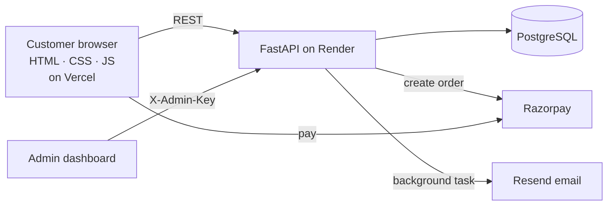

# 🧁 Cupcakes & Crumbs Co

**A full-stack online ordering system for a home bakery.** Customers browse the menu, build a cart and pay online with Razorpay. The baker gets an email for every new order and manages everything from an admin dashboard with sales analytics.

**🔗 Live site:** [cupcakesandcrumbsco.vercel.app](https://cupcakesandcrumbsco.vercel.app)


---

## Features

**For customers**
- Live menu loaded from the database (flavours, pack sizes, prices)
- Cart and checkout with validation (name, 10-digit phone, delivery address, order notes)
- Online payment through **Razorpay Checkout**, with amounts **computed on the server** from database prices so the client can't tamper with them

**For the bakery owner**
- Instant **email notification** for every order (via Resend), with an itemised bill
- **Admin dashboard** protected by an admin key:
  - pending orders with customer details and line items
  - mark orders as completed
  - **analytics**: total orders and revenue, weekly order and revenue trend, best-selling products, filterable by date range

## Architecture



## Tech stack

| Layer | Tools |
|---|---|
| Frontend | HTML, CSS, vanilla JavaScript (`index`, `menu`, `checkout`, `admin` pages) |
| Backend | FastAPI, Pydantic, psycopg2 |
| Database | PostgreSQL |
| Payments | Razorpay (test mode) |
| Email | Resend |
| Hosting | Vercel (frontend), Render (API + Postgres) |

## Getting started

### Prerequisites
- Python 3.10+
- PostgreSQL
- Razorpay test keys and a Resend API key (optional for local testing)

### 1. Install
```bash
git clone https://github.com/ChinmayKambali/cupcakesandcrumbsco.git
cd cupcakesandcrumbsco
python -m venv venv
source venv/bin/activate          # Windows: venv\Scripts\activate
pip install -r requirements.txt
```

### 2. Database
```bash
createdb cupcakes_db
psql -d cupcakes_db -f backend/schema.sql
```
Then add a few rows to `products` (see the example at the bottom of `schema.sql`).

### 3. Environment
```bash
cp backend/.env.example backend/.env
```
Fill in your database credentials, admin key, Razorpay and Resend keys.

### 4. Run
```bash
uvicorn backend.main:app --reload
```
API: http://127.0.0.1:8000 · Swagger docs: http://127.0.0.1:8000/docs

Open the files in `frontend/` with a static server (for example `python -m http.server -d frontend 5500`). Point `API_BASE` in the HTML files at your local API, and add your local origin to `origins` in `backend/main.py` for CORS.

## API

| Method | Endpoint | Auth | Description |
|---|---|---|---|
| `GET` | `/api/health` | none | Health check |
| `GET` | `/api/menu` | none | Active products |
| `POST` | `/api/payment/order` | none | Validate cart, price it server-side, create a Razorpay order |
| `POST` | `/api/orders` | none | Save order + send notification email |
| `GET` | `/api/admin/orders` | `X-Admin-Key` | Pending orders with items |
| `POST` | `/api/admin/orders/{id}/complete` | `X-Admin-Key` | Mark order completed |
| `GET` | `/api/admin/analytics?from_date=&to_date=` | `X-Admin-Key` | Revenue, weekly trend, top products |

## Project structure

```
cupcakesandcrumbsco/
├── backend/
│   ├── main.py            # FastAPI app & routes
│   ├── config.py          # env-based settings
│   ├── database.py        # Postgres connection
│   ├── payment_utils.py   # Razorpay order creation
│   ├── email_utils.py     # order emails via Resend
│   ├── schema.sql         # database schema
│   └── .env.example
├── frontend/
│   ├── index.html         # landing page
│   ├── menu.html          # menu
│   ├── checkout.html      # cart + Razorpay checkout
│   └── admin.html         # admin dashboard
└── requirements.txt
```

## Roadmap

- Verify Razorpay payment signatures on a webhook before confirming orders
- Order status updates to customers over email or WhatsApp
- Product image management from the admin panel

## License

[MIT](LICENSE) © Chinmay Kambali
